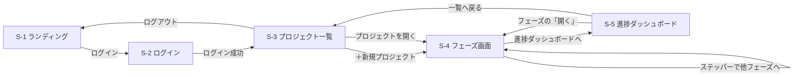

# 04. 画面設計

低精度ワイヤーフレーム。要素は固定ボキャブラリ（`header|text|button|input|image|list|nav|container|table`）のみを使い、インデントで入れ子構造（containerの中に要素）を表す。各画面にどの機能（FUNC-XXX）が対応するかも記載する。

## 画面一覧
| 画面 | ルート | 関連FUNC |
|---|---|---|
| S-1 ランディングページ | `/` | FUNC-004 |
| S-2 ログイン | `/login` | FUNC-001, FUNC-003 |
| S-3 プロジェクト一覧 | `/projects` | FUNC-010, FUNC-011, FUNC-012 |
| S-4 フェーズ画面 | `/projects/[id]/phases/[type]` | FUNC-020〜025, FUNC-030, FUNC-031, FUNC-060〜069 |
| S-5 進捗ダッシュボード | `/projects/[id]/progress` | FUNC-040〜042, FUNC-050〜052 |

---

## S-1 ランディングページ（`/`）
```
container (header)
  text: "Idea Design Machine"
  nav
    button: "ログイン"
container (hero)
  header: "AIと一緒に、優れた要件定義を。"
  text: "企画から実装TODOまで。実装は一切しない、設計に集中するためのアプリ。"
  button: "ログイン"
container (feature一覧)
  list
    text: "8つの工程を一本道で、抜け漏れなく"
    text: "成果物間の矛盾をAIが自動検出"
    text: "設計から実装TODOへの橋渡し"
```

## S-2 ログイン（`/login`）
```
container (center)
  header: "ログイン"
  input: "メールアドレス"
  input: "パスワード（マスク）"
  button: "ログイン"
  text: "（サインアップ機能はありません。admin専用）"
```

## S-3 プロジェクト一覧（`/projects`）
```
container (header)
  text: "Idea Design Machine"
  nav
    button: "ログアウト"
container (actions)
  button: "+ 新規プロジェクト"
list（プロジェクトカードの集まり）
  container (card) ×N
    text: プロジェクトタイトル
    text: 進捗（例: "3/8フェーズ完了"）
    button: "開く"
    button: "削除"
```

## S-4 フェーズ画面（`/projects/[id]/phases/[type]`）
左右2カラム構成。左=チャット、右=成果物（フェーズのformatに応じて表示が変わる）。

```
container (ヘッダー)
  nav（フェーズステッパー: 企画→要件定義→…→実装TODO、現在地と完了/要見直しを色で表現）
container (左カラム: チャット)
  list（チャットログ）
    text ×N（ユーザー発言／AI発言を区別して表示）
  input: "メッセージを入力"
  button: "送信"
  container (確定提案バナー・条件表示)
    text: "この内容で確定しますか？"
    button: "確定する"
    button: "まだ続ける"
container (右カラム: 成果物。formatにより中身が切り替わる)
  # 構造化リスト（企画・要件定義・機能設計・詳細設計・テスト設計）
  table
    text: "ID / タイトル / 説明 / 優先度 / 関連ID"
  button: "＋ 項目を追加"
  button: 各行に "編集" "削除"

  # ワイヤーフレーム（画面設計）
  list（画面タブ）
  container（選択中の画面のプレビュー: ヘッダー/テキスト/ボタン等をボックス表示）
  button: "＋ 要素を追加"
  container（画面遷移図）
    image（Mermaid flowchartレンダリング結果のSVG。画面同士のつながりを表示）
    input: "Mermaidソースを編集（テキストエリア代替）"
    button: "再レンダリング"
  container（デザインイメージ。画面タブごと）
    image（OpenAI生成画像。未生成なら空状態表示）
    input: "見た目のフィードバックを入力"
    button: "生成／ブラッシュアップ"

container（Markdown表示切替。全format共通）
  nav
    button: "構造化ビュー"
    button: "Markdownで見る"
  text（Markdownで見る選択時: 変換結果をそのまま表示）
  button: "コピー"

  # ER図（DB設計）
  image（Mermaidレンダリング結果のSVG）
  input: "Mermaidソースを編集（テキストエリア代替）"
  button: "再レンダリング"

  # チェックリスト（実装TODO、ヒアリングなし）
  list
    text + button（チェックボックス代替）×N
  container（このフェーズがNEEDS_REVIEWの時のみ表示）
    text: "上流の内容が変わりました"
    button: "問題なし"
    button: "再生成（チェック済みは維持されます）"
```

## S-5 進捗ダッシュボード（`/projects/[id]/progress`）
```
container (ヘッダー)
  text: "進捗状況"
container (フェーズステータス一覧)
  table
    text: "フェーズ名 / ステータス（未着手・進行中・完了・要見直し）"
    button: 各行に "開く"（NOT_STARTED以外の行のみ。クリックでそのフェーズ画面S-4へ遷移）
container (整合性チェック)
  button: "整合性チェックを実行"
  list（チェック結果）
    text: 矛盾点の説明 ×N
```

## 画面遷移図


## 次フェーズへの引き継ぎメモ
- DB設計フェーズでは、ここで出てきた「プロジェクトカード」「チャットログ」「構造化リスト項目」「チェックリスト項目」「整合性チェック結果」などの表示単位から、必要なテーブルとカラムを洗い出す。
