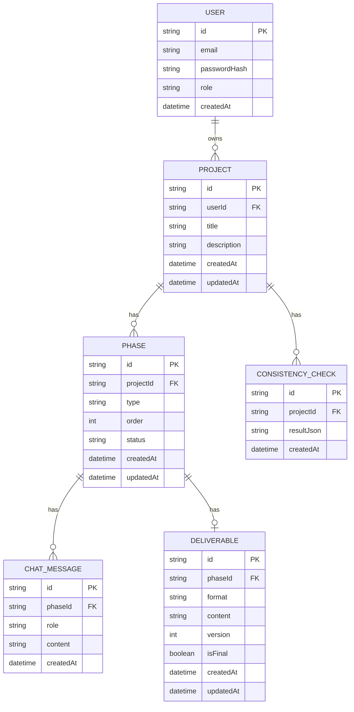

# 05. DB設計

機能設計・画面設計で洗い出した表示単位（プロジェクトカード、チャットログ、構造化リスト項目、チェックリスト項目、整合性チェック結果など）から導出したテーブル構成。PostgreSQL（Prisma）を想定。

## ER図

## テーブル定義

### User
| カラム | 型 | 制約 | 説明 |
|---|---|---|---|
| id | string(uuid) | PK | |
| email | string | unique | ログインID |
| passwordHash | string | | bcryptハッシュ |
| role | enum(ADMIN, USER) | | v1では必ずADMIN。将来の一般公開に備えて保持 |
| createdAt | datetime | | |

### Project
| カラム | 型 | 制約 | 説明 |
|---|---|---|---|
| id | string(uuid) | PK | |
| userId | string | FK→User, onDelete Cascade | 所有者 |
| title | string | | |
| description | string? | nullable | |
| createdAt / updatedAt | datetime | | |

### Phase
| カラム | 型 | 制約 | 説明 |
|---|---|---|---|
| id | string(uuid) | PK | |
| projectId | string | FK→Project, onDelete Cascade | |
| type | enum PhaseType | | PLANNING, REQUIREMENTS, FUNCTIONAL_DESIGN, SCREEN_DESIGN, DB_DESIGN, DETAILED_DESIGN, TEST_DESIGN, IMPLEMENTATION_CHECKLIST |
| order | int | | 1〜8。工程順の固定表示・進行制御に使う |
| status | enum PhaseStatus | | NOT_STARTED, IN_PROGRESS, DONE, NEEDS_REVIEW |
| createdAt / updatedAt | datetime | | |
| — | — | unique(projectId, type) | 1プロジェクトにつき各typeは1つだけ |

### ChatMessage
| カラム | 型 | 制約 | 説明 |
|---|---|---|---|
| id | string(uuid) | PK | |
| phaseId | string | FK→Phase, onDelete Cascade | |
| role | enum(user, assistant) | | |
| content | text | | |
| createdAt | datetime | | 表示順に使用 |

### Deliverable
| カラム | 型 | 制約 | 説明 |
|---|---|---|---|
| id | string(uuid) | PK | |
| phaseId | string | FK→Phase, unique（1 Phaseに1 Deliverable） | |
| format | enum(STRUCTURED_LIST, ER_DIAGRAM, WIREFRAME, CHECKLIST) | | phase.typeに対応して決まる |
| content | json | | 下記「contentの形」参照 |
| version | int | | 再確定のたびにインクリメント |
| isFinal | boolean | | 確定済みかどうか |
| createdAt / updatedAt | datetime | | |

### ConsistencyCheck
| カラム | 型 | 制約 | 説明 |
|---|---|---|---|
| id | string(uuid) | PK | |
| projectId | string | FK→Project, onDelete Cascade | |
| resultJson | json | | `{ findings: [...], summary }` |
| createdAt | datetime | | 実行履歴として複数件持てる |

## Deliverable.contentの形（formatごと）
- **STRUCTURED_LIST**（企画・要件定義・機能設計・詳細設計・テスト設計）
  `{ items: [{ id: "REQ-001", title, description, priority: "Must"|"Should"|"Could", relatedIds: string[] }] }`
- **ER_DIAGRAM**（DB設計）
  `{ mermaid: string, entities: [{ name, fields: [{ name, type, isPK, isFK }] }] }`
- **WIREFRAME**（画面設計）
  `{ screens: [{ name, elements: WireframeElement[] }], transitionsMermaid: string, designImages: [{ screenName: string, imageBase64: string, prompt: string }] }`（要素種別は`header|text|button|input|image|list|nav|container|table`、再帰的にネスト可。`transitionsMermaid`は画面同士のつながりを表すMermaid flowchartのソース。`designImages`は画面ごとの参考デザイン画像。`imageBase64`はOpenAI画像生成APIの結果をそのまま保存し、`prompt`は直近に使った生成プロンプト＝次回ブラッシュアップ時の編集ベースとして使う）
- **CHECKLIST**（実装TODOチェックリスト）
  `{ items: [{ id, label, relatedFunctionalItem?, done: boolean }] }`

## 補足
- `userId`による全テーブルのスコープ分離は、Project起点のリレーションを辿ることで保証する（Phase/ChatMessage/Deliverable/ConsistencyCheckは直接userIdを持たない）。
- 「戻って編集」（FUNC-040〜042）はPhase.statusの更新のみで表現し、履歴やバージョン管理用の別テーブルは持たない（アプリ内蔵のスナップショット機能は将来拡張）。
- 各フェーズのMarkdown表示（FUNC-068）は、`Deliverable.content`を都度テキストに変換して生成する派生表示であり、Markdown専用のカラムやテーブルは持たない。
- デザインイメージ（FUNC-066, 067）は`WIREFRAME`のcontent内に保存するのみで、専用のテーブルやファイルストレージは持たない（プロトタイプ規模のためDB内base64保存で足りる）。
